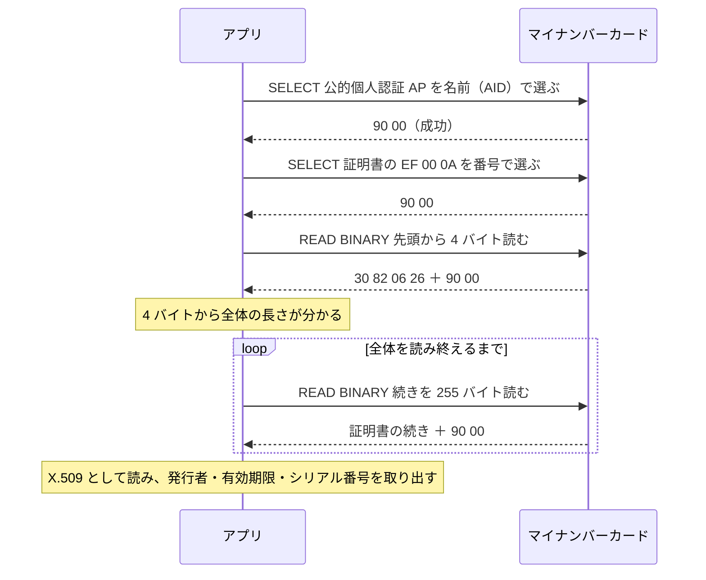
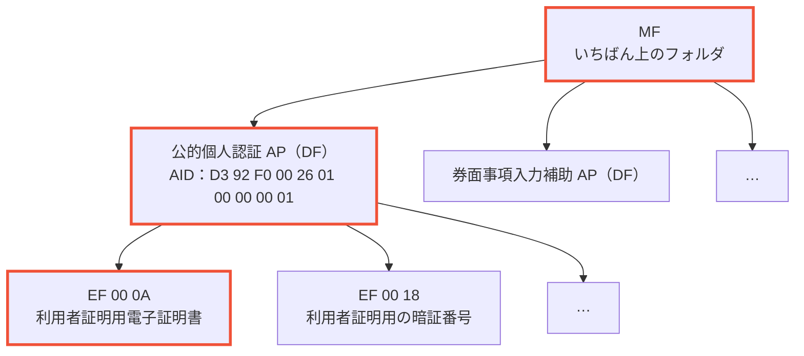
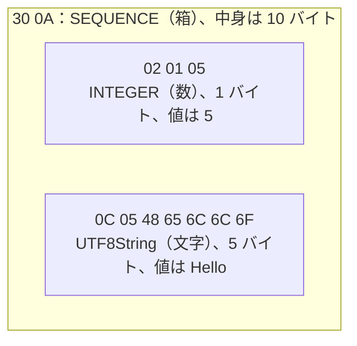
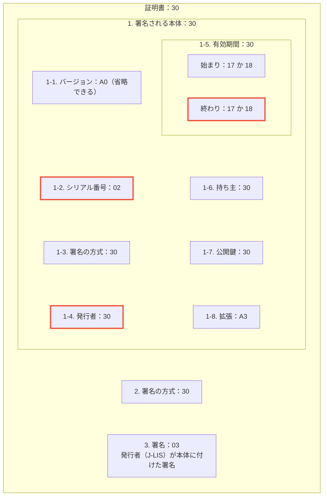
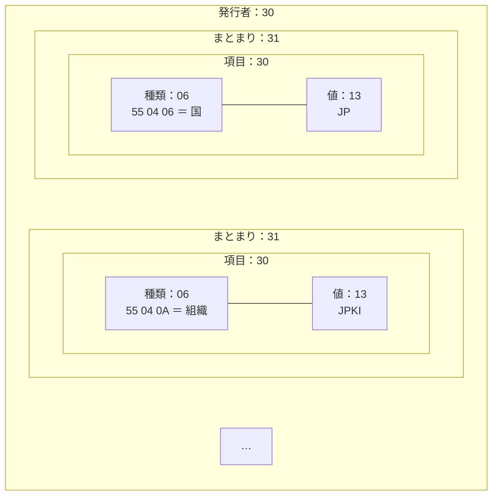

# NFCKit

マイナンバーカードの IC チップを Core NFC で読み取る iOS SDK


## 用語

IC カードとの通信に出てくる言葉を、利用者証明用電子証明書を読む流れに沿って説明する。

### 読み取りの流れ

アプリとカードの会話は、「お願い」と「返事」の繰り返しである。証明書を読むときは、次の順に会話する。



図に出てくる言葉と、この節での説明の場所を、次の表に挙げる。

| 用語 | 図のどこか | ひとことで |
| --- | --- | --- |
| [AP・EF・AID](#カードの中身apdfefaid) | 選ぶ相手 | カードの中のフォルダとファイル |
| [APDU](#apduapplication-protocol-data-unit) | 矢印 1 本 | お願いと返事の書式 |
| [ステータスワード](#ステータスワードsw1sw2) | `90 00` | 返事の最後に付く結果のコード |
| [BER-TLV](#ber-tlv) | `30 82 06 26` と続き | 返事の中身の書き方 |
| [X.509](#x509) | 最後の Note | BER-TLV で書かれた証明書の決まり |
| [SELECT・READ BINARY・VERIFY](#命令selectread-binaryverify) | 矢印の名前 | カードへの命令 |

### カードの中身（AP・DF・EF・AID）

IC カードの中は、パソコンのフォルダとファイルのような木の形になっている。太枠は、このリポジトリがたどる道である。



| 用語 | ひとことで | 例 |
| --- | --- | --- |
| AP（アプリケーション） | カードの中の「用途ごとのアプリ」 | 公的個人認証 AP |
| DF（Dedicated File） | フォルダ。AP は DF として入っている | 公的個人認証 AP |
| EF（Elementary File） | 中身のあるファイル。2 バイトの番号で呼ぶ | `00 0A` |
| AID（Application Identifier） | AP の世界で一つだけの名前 | `D3 92 F0 00 26 01 00 00 00 01` |

「AP を選ぶ → EF を選ぶ → 中身を読む」は、ターミナルで `cd` してから `cat` するのと同じ流れである。

### APDU（Application Protocol Data Unit）

カードとの会話 1 往復分の書式である。アプリが送るものを「コマンド APDU」、カードが返すものを「レスポンス APDU」と呼ぶ。

#### コマンド APDU（お願い）

証明書を読むときに送るバイト列を、欄ごとに分けると次のようになる。先頭の 4 欄は必ず付き、残りは必要なときだけ付く。

| 命令 | CLA | INS | P1 | P2 | Lc | データ | Le |
| --- | --- | --- | --- | --- | --- | --- | --- |
| 公的個人認証 AP を選ぶ | `00` | `A4` | `04` | `0C` | `0A` | `D3 92 F0 00 26 01 00 00 00 01` | |
| 証明書の EF を選ぶ | `00` | `A4` | `02` | `0C` | `02` | `00 0A` | |
| 先頭から 4 バイト読む | `00` | `B0` | `00` | `00` | | | `04` |
| 4 バイト目から 255 バイト読む | `00` | `B0` | `00` | `04` | | | `FF` |

各欄の意味は、次の表のとおりである。

| 欄 | 意味 | 例 |
| --- | --- | --- |
| CLA | 命令のおおまかな種類。このリポジトリでは常に `00` | `00` |
| INS | 何をしてほしいか | `A4` 選ぶ、`B0` 読む、`20` 暗証番号を照合する |
| P1・P2 | 命令ごとの細かい指定 | `04` 名前で選ぶ、`02` 番号で選ぶ、読み始める位置 |
| Lc | 送るデータが何バイトか | 10 バイトなら `0A` |
| データ | 送る中身 | AID、EF の番号、暗証番号 |
| Le | 返してほしいデータの最大バイト数 | `04` は 4 バイト、`00` は 256 バイト |

READ BINARY では、P1 と P2 の 2 バイトが「何バイト目から読むか」を表す。使えるのは 15 ビット分なので、指定できる位置は 0〜32767 になる。

Lc と Le があるかないかで、形が 4 通りに分かれる。

| ケース | Lc・データ | Le | 使う場面 |
| --- | --- | --- | --- |
| 1 | | | 暗証番号の残り回数を聞く（データなしの VERIFY） |
| 2 | | あり | ファイルを読む（READ BINARY） |
| 3 | あり | | AP や EF を選ぶ（SELECT）、暗証番号を照合する |
| 4 | あり | あり | データを送り、データも受け取る |

#### レスポンス APDU（返事）

返事は、データと、最後に必ず付く 2 バイトのステータスワードでできている。データの無い返事もある。

| 場面 | データ | SW1 | SW2 |
| --- | --- | --- | --- |
| AP や EF を選べた | | `90` | `00` |
| 先頭の 4 バイトを読めた | `30 82 06 26` | `90` | `00` |
| AP が見つからない | | `6A` | `82` |

### ステータスワード（SW1・SW2）

返事の最後に必ず付く 2 バイトの結果コードである。Web の `200` や `404` と同じ役割を持つ。

| 値 | 意味 |
| --- | --- |
| `90 00` | うまくいった |
| `63 CX` | 暗証番号が違った、または残り回数を聞かれた。X が残りの回数 |
| `69 83` | 暗証番号がロックされている |
| `69 82` | 条件を満たしていない（たとえば、先に暗証番号が必要） |
| `6A 82` | 選んだ AP やファイルが見つからない |

`63 CX` は、2 バイト目の上半分が `C`、下半分が回数である。`63 C2` なら残り 2 回になる。

### BER-TLV

返事の中身を書くためのルールである。どのデータも「種類（Tag）・長さ（Length）・中身（Value）」の 3 つ組で書く。中身の中に、さらに 3 つ組を入れられる。

次のバイト列を例に、3 つ組の入れ子を図にする。

```
30 0A 02 01 05 0C 05 48 65 6C 6C 6F
```



同じバイト列を Tag・Length・Value に分けると、次の表になる。

| バイト列 | Tag | Length | Value |
| --- | --- | --- | --- |
| `30 0A …` | `30` SEQUENCE | `0A`（10 バイト） | 下の 2 つ |
| `02 01 05` | `02` INTEGER | `01`（1 バイト） | `05`（5） |
| `0C 05 48 65 6C 6C 6F` | `0C` UTF8String | `05`（5 バイト） | `48 65 6C 6C 6F`（Hello） |

#### 種類（Tag）

先頭の 1 バイトのビットにも意味がある。右から 6 番目のビット（`0x20`）が 1 なら、中にさらに 3 つ組が入っている箱である。

| Tag | 意味 | 箱か |
| --- | --- | --- |
| `30` | SEQUENCE（順番のある並び） | 箱 |
| `31` | SET（順番のない集まり） | 箱 |
| `A0` | 文脈で意味が決まる [0] | 箱 |
| `02` | INTEGER（数） | 中身 |
| `06` | OID（項目の種類を表す番号） | 中身 |
| `13`・`0C` | 文字列 | 中身 |

#### 長さ（Length）

長さの書き方は、先頭のバイトで決まる。

| 先頭のバイト | 読み方 | 例 |
| --- | --- | --- |
| `00`〜`7F` | そのまま長さ | `05` は 5 バイト |
| `81` | 次の 1 バイトが長さ | `81 C8` は 200 バイト |
| `82` | 次の 2 バイトが長さ | `82 06 26` は 1574 バイト |

証明書の先頭は `30 82 XX XX` である。この 4 バイトを読めば全体の長さが分かるので、最初に 4 バイトだけ読む。

#### DER

DER は、BER の書き方を 1 通りに絞ったものである（たとえば、長さは必要最小限のバイト数で書く）。証明書は DER で書かれている。DER は BER の一種なので、BER を読む仕組みでそのまま読める。

### X.509

電子証明書の世界共通の形式である。HTTPS で使われる証明書と同じ形式で、マイナンバーカードの電子証明書もこれを使う。中身は DER の箱の入れ子になっている。番号は箱の中での並び順で、太枠はこのリポジトリが取り出す項目である。



取り出す項目の書かれ方を、次の表にまとめる。

| 項目 | Tag | 表示するときの扱い |
| --- | --- | --- |
| [シリアル番号](#シリアル番号) | `02`（INTEGER） | 先頭の `00` を取り除き、16 進の文字列にする。`print` では `****` と出る |
| [発行者](#発行者) | `30`（SEQUENCE） | 項目を `C=JP, O=JPKI, …` の形に並べる |
| [有効期限](#有効期限) | `17` か `18`（時刻） | カードに書かれた期限をそのまま出す |

#### シリアル番号

発行者が証明書ごとに付ける番号である。数（`02`）として書かれているので、先頭が `00` のことがある。これは「マイナスの数ではない」ことを示すためだけのバイトなので、取り除いて表示する。

本人と結び付く値なので、`print` しても `****` としか出ないようにしている。

#### 発行者

「どこが発行したか」を表す。発行者は、まとまり（SET）の中に項目（SEQUENCE）が入る 3 段の箱になっている。



1 つのまとまりには項目を複数入れられる決まりなので、読むときは「まとまり」と「項目」の 2 段でたどる。種類の OID と表示は、次の表のとおりである。

| OID | 意味 | 表示 |
| --- | --- | --- |
| `55 04 03` | 名前 | CN |
| `55 04 06` | 国 | C |
| `55 04 0A` | 組織 | O |
| `55 04 0B` | 部署 | OU |

#### 有効期限

時刻には 2 通りの書き方がある。どちらも最後の `Z` は「世界標準時（UTC）」という意味である。日本時間に直すと 9 時間進む。

| Tag | 書き方 | 例 |
| --- | --- | --- |
| `17`（UTCTime） | 年が 2 桁：`YYMMDDHHMMSSZ` | `310101000000Z` は 2031 年 1 月 1 日 0 時 |
| `18`（GeneralizedTime） | 年が 4 桁：`YYYYMMDDHHMMSSZ` | `20500101000000Z` は 2050 年 1 月 1 日 0 時 |

年が 2 桁のときは、50 以上なら 1900 年代、49 以下なら 2000 年代と読む。

> [!NOTE]
> 画面に出す有効期限は、カードに書かれた期限である。期限内でも、失効しているかどうかはサーバーで J-LIS に問い合わせないと分からない。

### 命令（SELECT・READ BINARY・VERIFY）

このリポジトリで送る命令を、次の表に挙げる。

| 命令 | INS | すること | 例えると | 暗証番号の残り回数 |
| --- | --- | --- | --- | --- |
| SELECT | `A4` | AP や EF を選ぶ | `cd` | 減らない |
| READ BINARY | `B0` | 選んだ EF の中身を読む | `cat` | 減らない |
| VERIFY | `20` | 暗証番号を照合する。データを付けなければ残り回数を聞くだけ | ログイン | **違う暗証番号を送ったときだけ減る** |

利用者証明用電子証明書の読み取りでは、VERIFY を一度も送らない。そのため、何度試しても暗証番号の残り回数は減らない。

## 動かし方

Xcode と [Homebrew](https://brew.sh/) が要る。ほかの道具は `make setup` で入る。

| 道具 | 使い道 |
| --- | --- |
| [Mint](https://github.com/yonaskolb/Mint) | SwiftFormat の版をそろえる（`Mintfile`） |
| [pre-commit](https://pre-commit.com/) | commit の前の確認を動かす |

> [!NOTE]
> commit の前に pre-commit が、ステージした Swift を SwiftFormat で整形する。直したファイルがあると commit は止まるので、`git add` して commit し直す。

よく使うコマンドを、次の表に挙げる。

| 対象 | コマンド |
| --- | --- |
| 道具を入れ、hook を入れる | `make setup` |
| テスト（Mac の上） | `make test` |
| Swift の整形 | `make format` |
| 整形の確認 | `make lint` |

## 出典

用語と値は、次の規格と資料に基づく。

| 資料 | 使ったところ |
| --- | --- |
| ISO/IEC 7816-4:2005 | APDU、ステータスワード、BER-TLV、SELECT・READ BINARY・VERIFY |
| [RFC 5280](https://www.rfc-editor.org/rfc/rfc5280) | X.509 の構造、シリアル番号、Name、時刻の書き方 |
| [OpenSC `jpki.h`](https://github.com/OpenSC/OpenSC/blob/66f7c34517723ee0aded01d697a210c00f3e85f2/src/libopensc/jpki.h)・[`pkcs15-jpki.c`](https://github.com/OpenSC/OpenSC/blob/a6587f0ac26af9c78f90b70ec5132847f3c8717a/src/libopensc/pkcs15-jpki.c) | 公的個人認証 AP の AID と EF の番号 |
| [マイナンバーカード開発者ポータル「マイナンバーカードの中身まとめ」](https://portal.mynumber.dev/mynumber-apdu/summary) | AID と EF の番号 |
